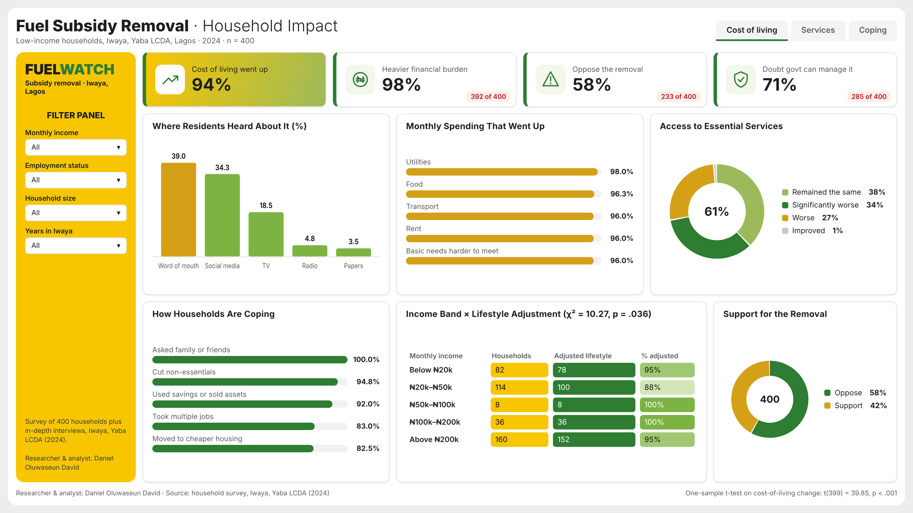

# Fuel Subsidy Removal Impact Analysis (Iwaya, Lagos)

When the petrol subsidy was removed in 2023, the price of almost everything went up. This project looks at what that did to low-income households in Iwaya, Yaba LCDA: how their cost of living changed, what they cut back on, whether they can still get essential services, and how they are coping. The study surveyed 400 households and followed up with in-depth interviews. I did the analysis.

Key Points:
* Rising costs: transport, food, rent and utilities all went up at the same time.
* Low trust: most residents do not believe the reasons the government gave.
* Coping: households are cutting back, using up their savings and leaning on family.

Tools I used: SPSS, SQL Server, Python (pandas), Excel, Power BI

Data: 400 households in Iwaya, collected in 2024. The figures here come from the frequency tables in the final report.

## Objectives
1. Measure the change in cost of living
2. Find out how consumption patterns changed
3. Check access to essential services
4. Document the coping strategies households use

## Dashboard


## What I found
* 94% said their cost of living went up and 98% said their household is under more financial pressure. The one-sample t-test confirms the change is significant (t = 39.85, df = 399, p < .001).
* Nearly everyone is spending more on utilities (98%), food (96%), transport (96%) and rent (96%).
* 61% said their access to essential services has got worse.
* 58% are against the removal, 67% don't believe the government's reasons for it, and 71% don't think the government can handle the effects.
* Every household (100%) has asked family or friends for help. 92% have used savings or sold things and 83% have taken on extra jobs.
* How much a household earns is linked to whether it changed its lifestyle (χ² = 10.27, df = 4, p = .036).

## Recommendations
* Targeted transport and food relief for low-income households
* Better public communication, because most people heard about the policy by word of mouth, not from official channels
* Support community programmes, which most households already depend on
* Keep track of access to health and education as prices keep rising

## Repo structure
```
Data/
  frequency_tables.csv     every frequency table from the report in one table
Scripts/
  dim_questions.sql
  fact_frequencies.sql
Frequency Analysis/
  percentages.py
  frequency_tables_with_percentages.csv
Dashboard/
  dashboard.png / dashboard.html
  Excel workbook (dashboard, a chart for every table, data, tests)
```

## How to run it
1. In SQL Server create a database called IwayaFuelSurveyDB and import `Data/frequency_tables.csv` as `dbo.frequency_tables` (Tasks > Import Flat File).
2. Run `Scripts/dim_questions.sql` and `Scripts/fact_frequencies.sql`.
3. Load the query results into Power BI (Get data > SQL Server) to build the dashboard.
4. Run `Frequency Analysis/percentages.py`. It reads from SQL Server, or from the CSV if SQL Server is not set up.


Researcher and analyst: Daniel Oluwaseun David. No names or personal details are included.
